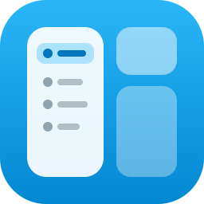
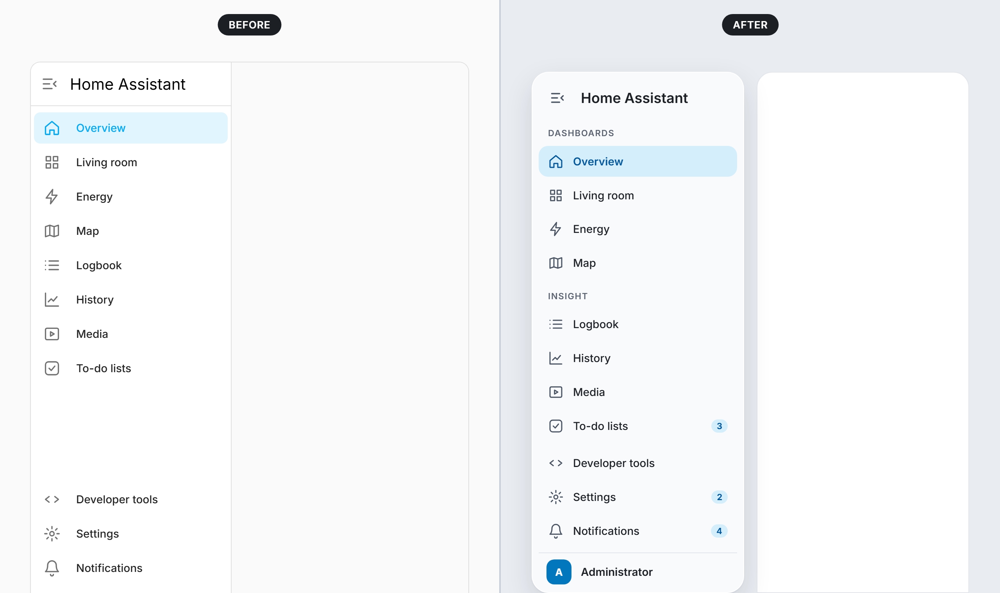
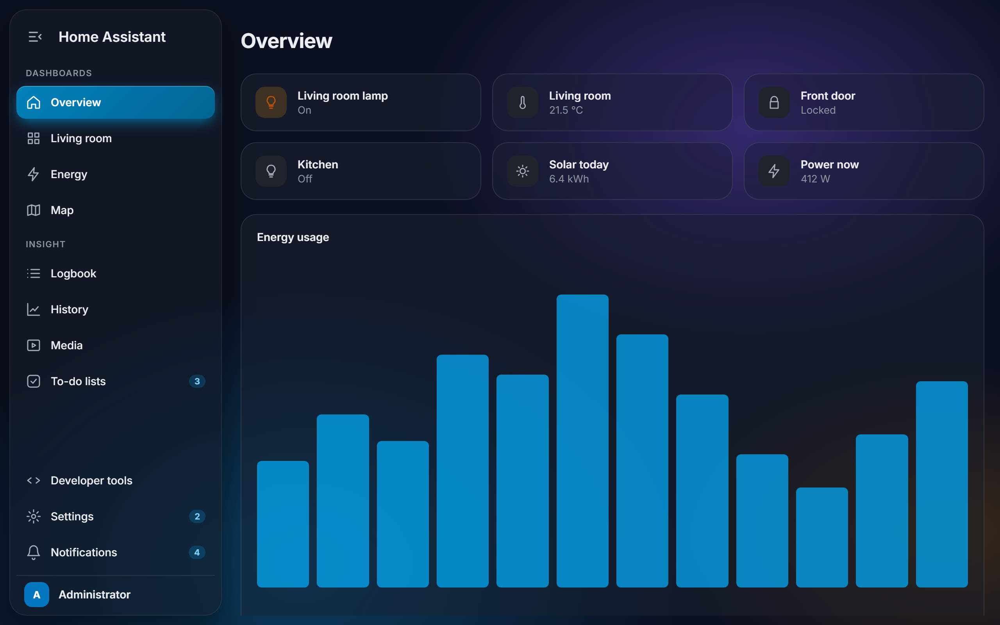
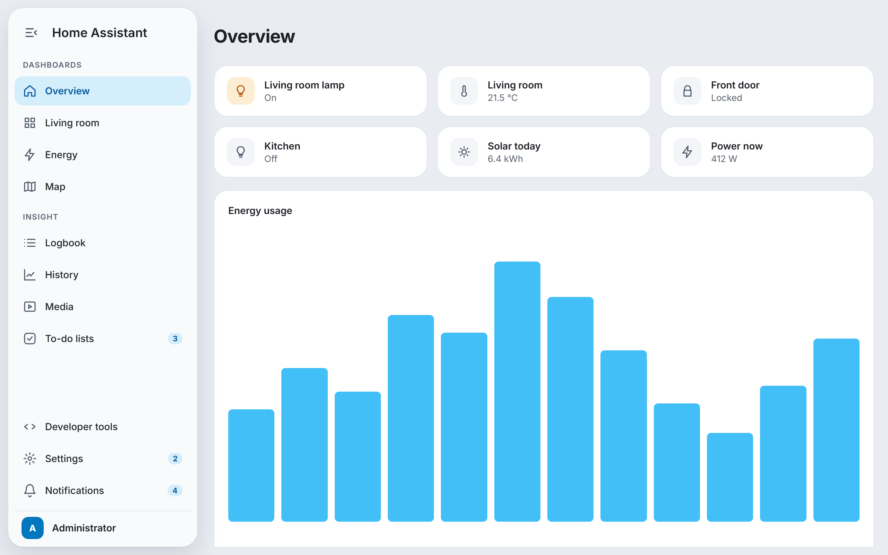
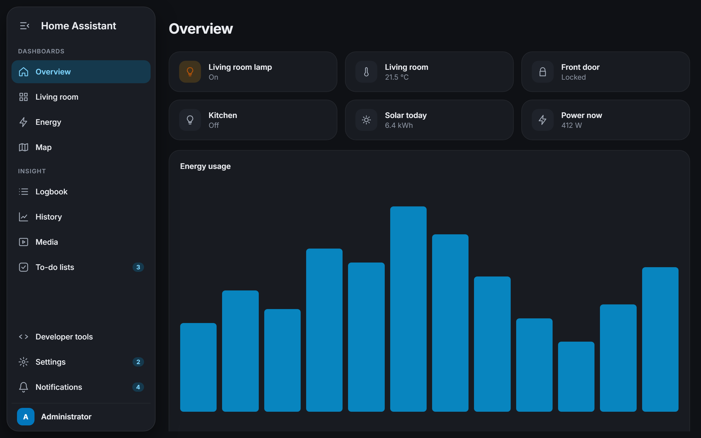
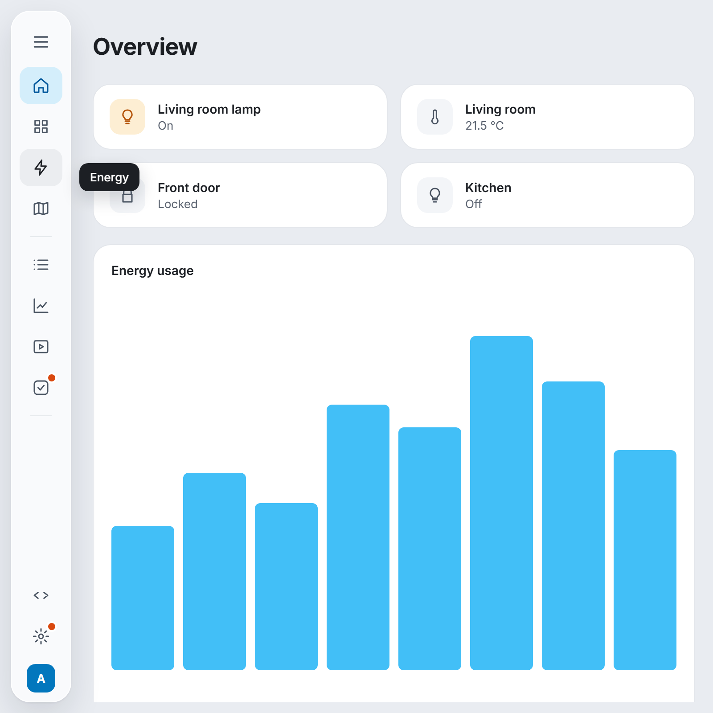
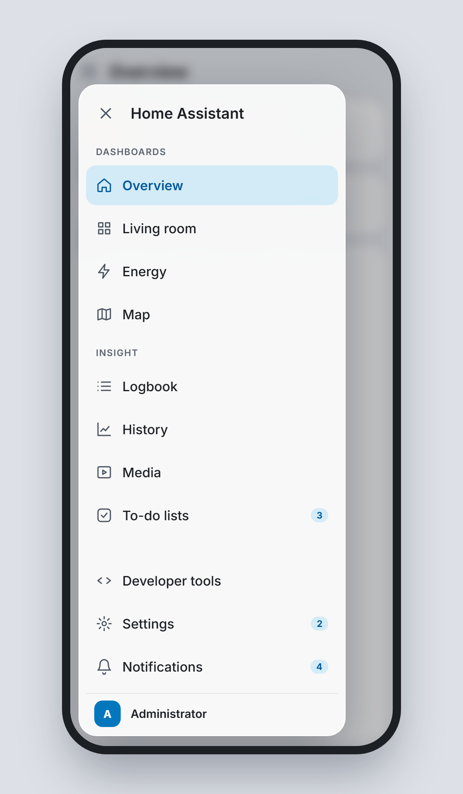
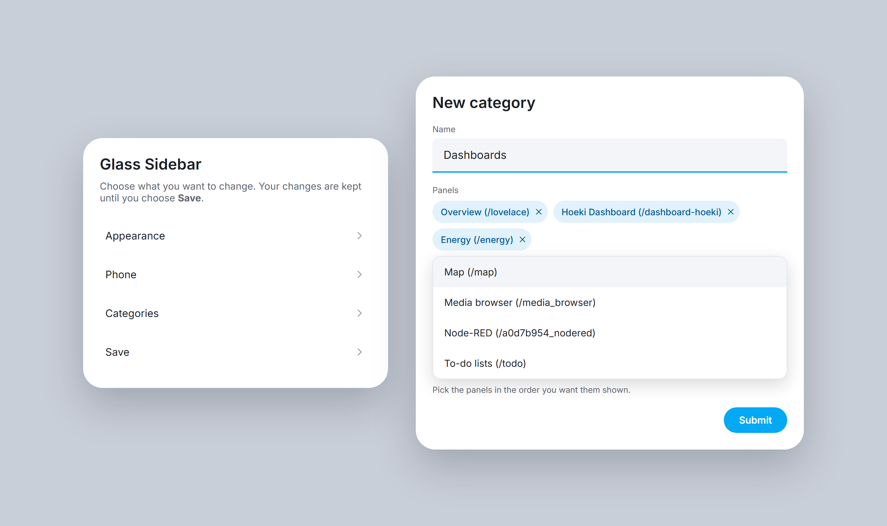

# Glass Sidebar for Home Assistant

A modern, glass-style sidebar for Home Assistant. It turns the left navigation
into a floating panel with soft blur, rounded items and a clear highlight for
the page you're on — and lets you group your panels into your own categories.

It follows your active Home Assistant theme, works in light and dark mode, and
is configured entirely from the UI. No YAML, no extra frontend resources.

> The images on this page are design previews of the plugin's look. Your
> sidebar uses your own theme colors, panels and names.

## Features

- **Floating glass panel** with configurable distance to the screen edge,
  corner radius and blur.
- **Categories**: group panels under your own headings, such as
  *Dashboards* and *Insight*, picked from a list of your panels. Collapsed,
  each heading becomes a thin divider.
- **Vivid highlight** (optional): the page you're on gets a solid accent pill
  with a soft glow.
- **Glass dashboard cards** (optional): your cards get the same frosted look.
- **Theme aware**: uses your theme's colors, or an accent color of your own.
- **Phone drawer**: on phones the menu opens wider, with larger touch targets
  and a blurred page behind it. Tablets and desktops keep the normal layout.
- **Subtle motion**: icons slide slightly on hover. Can be turned off, and is
  off automatically when your device asks for reduced motion.
- **Settings menu**: everything is set up from a menu in Home Assistant and
  applies immediately in every open browser, without a reload.

## Screenshots

| Light | Dark |
| --- | --- |
|  |  |

| Collapsed | Phone |
| --- | --- |
|  |  |

## Installation

### Marketplace (Home Assistant 2026.11 and newer)

From Home Assistant 2026.11, HACS is built in as the **Marketplace** under
**Settings → Marketplace**. Search for **Glass Sidebar** there. If it isn't
listed yet, add this repository as a custom repository with type
**Integration**, the same way as described for HACS below. If you installed it
through HACS before, it carries over automatically and keeps getting updates.

### HACS (Home Assistant 2026.10 and older)

Click the button above, or add it by hand:

1. In Home Assistant, open **HACS**.
2. Open the menu (⋮) in the top right and choose **Custom repositories**.
3. Add `https://github.com/roykolk20-design/Home-assistant-glasssidebar` with
   type **Integration** (not *Theme* or *Dashboard*, those give a
   "repository structure is not compliant" error).
4. Search for **Glass Sidebar** in HACS and download it.
5. Restart Home Assistant.
6. Go to **Settings → Devices & services → Add integration** and choose
   **Glass Sidebar**.
7. Refresh your browser (Ctrl+F5 / Cmd+Shift+R).

### Manual

1. Download this repository (green **Code** button → **Download ZIP**).
2. Copy the folder `custom_components/glass_sidebar` into the
   `custom_components` folder of your Home Assistant configuration, so you end
   up with `config/custom_components/glass_sidebar/manifest.json`.
3. Restart Home Assistant.
4. Go to **Settings → Devices & services → Add integration** and choose
   **Glass Sidebar**.
5. Refresh your browser.

## Configuration

Go to **Settings → Devices & services → Glass Sidebar → Configure**. A menu
opens with **Appearance**, **Phone**, **Categories** and **Save**. Your changes
are kept while you move between pages and stored when you choose **Save**.

### Appearance

| Option | Default | What it does |
| --- | --- | --- |
| Floating | On | Shows the sidebar as a separate panel with space around it. Off keeps it attached to the screen edge. |
| Distance to screen edge | 8 px | Space around the floating panel. |
| Corner radius | 20 px | Roundness of the panel. Menu items follow along. |
| Blur | 18 px | Strength of the glass blur. Also used for glass cards. |
| Panel opacity | 74 % | Lower is more see-through. |
| Selected item | Soft tint | *Soft tint* or *Vivid with glow*. |
| Use my own accent color | Off | Off follows your theme. On uses the **Accent color** below. |
| Hover animation | On | Icons slide slightly when you point at them. |
| Glass dashboard cards | Off | Makes cards translucent. Best with a background image; can be heavy on older tablets. |

### Phone

Applies to screens up to 600 px wide.

| Option | Default | What it does |
| --- | --- | --- |
| Drawer width | 300 px | Width of the menu when it slides in. Never more than 90 % of the screen. |
| Blur the page behind the menu | On | Frosts the dashboard while the menu is open. |

### Categories

Choose **Add a category**, give it a name and pick its panels from the list.
The list shows every panel in your sidebar with its address, for example
*Energy (/energy)*. Panels appear in the order you pick them.

With **Edit or remove a category** you can rename a category, change its
panels, move it to another position or remove it.

Panels you don't put in a category stay at the top in Home Assistant's own
order. Settings, notifications and your profile always stay at the bottom. A
panel in two categories appears in the first one. The order and visibility you
set with Home Assistant's own *Edit sidebar* (long-press the title) still
apply.

Categories written as text in version 1.1 are taken over automatically.

## Updates

New versions are published as GitHub releases. HACS shows them under
**Settings → Updates** like any other update, with the release notes. Install
it there, restart Home Assistant when asked and refresh your browser.

HACS never installs updates on its own. If you want that, create an
automation that runs the `update.install` action on the Glass Sidebar update
entity when it turns on.

## Compatibility

- Built for **Home Assistant 2026.10** (frontend 20260930) and newer.
- The sidebar is part of Home Assistant's frontend, which isn't a public API.
  A future frontend update can change the elements this plugin styles. If the
  sidebar suddenly looks like the default again after an update, please
  [open an issue](https://github.com/roykolk20-design/Home-assistant-glasssidebar/issues).

## Troubleshooting

**Nothing changes after installing.**
Make sure you added the integration under *Devices & services* (installing
through HACS alone isn't enough), then hard-refresh the browser. In the
companion app: *Settings → Companion app → Debugging → Reset frontend cache*.

**A category doesn't show up.**
A heading only appears when at least one of its panels is in your sidebar.
Check that the panel isn't hidden with *Edit sidebar*. Headings are hidden on
the collapsed sidebar and shown as dividers instead.

**Keyboard navigation follows a different order.**
Categories only change the visual order. Arrow-key navigation inside the
sidebar still follows Home Assistant's original order. This is intentional:
moving the actual elements would break Home Assistant's own updates of the
sidebar.

**Still stuck?** Open the browser console (F12), look for messages that start
with `Glass Sidebar`, and include them in an issue together with your Home
Assistant version.

## Uninstall

1. **Settings → Devices & services → Glass Sidebar → ⋮ → Delete**. The
   sidebar returns to normal right away.
2. Remove the integration in HACS (or delete
   `custom_components/glass_sidebar`) and restart Home Assistant.

## How it works

The integration serves one small JavaScript file and asks Home Assistant to
load it in the frontend. The script finds the sidebar inside Home Assistant's
shadow DOM and adds a stylesheet to it. Your options are sent to the browser
over Home Assistant's websocket, so changes apply instantly. Categories use
CSS `order` and extra headings. The sidebar's own elements are never moved or
replaced.

## License

[MIT](LICENSE)
