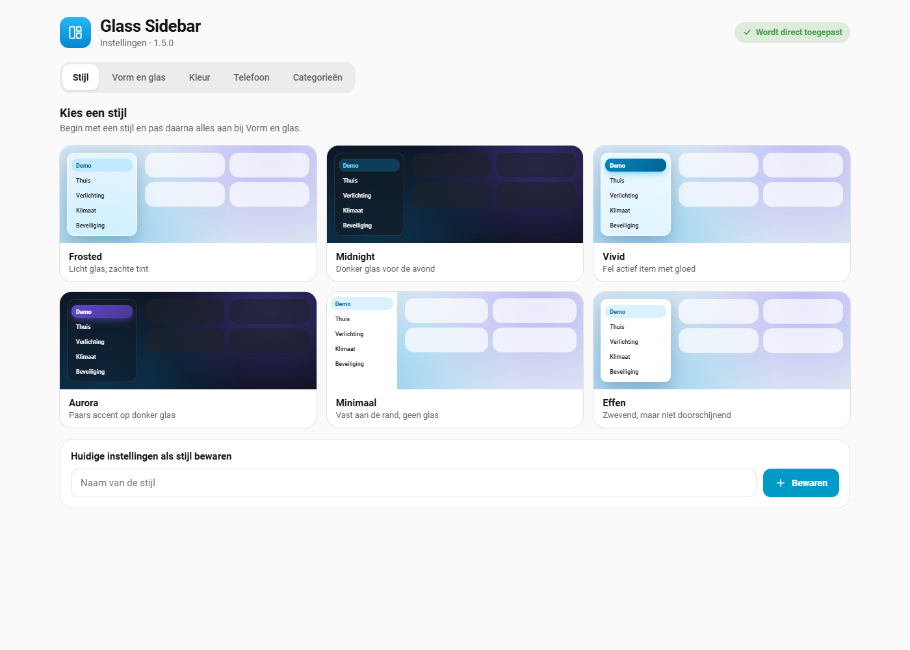
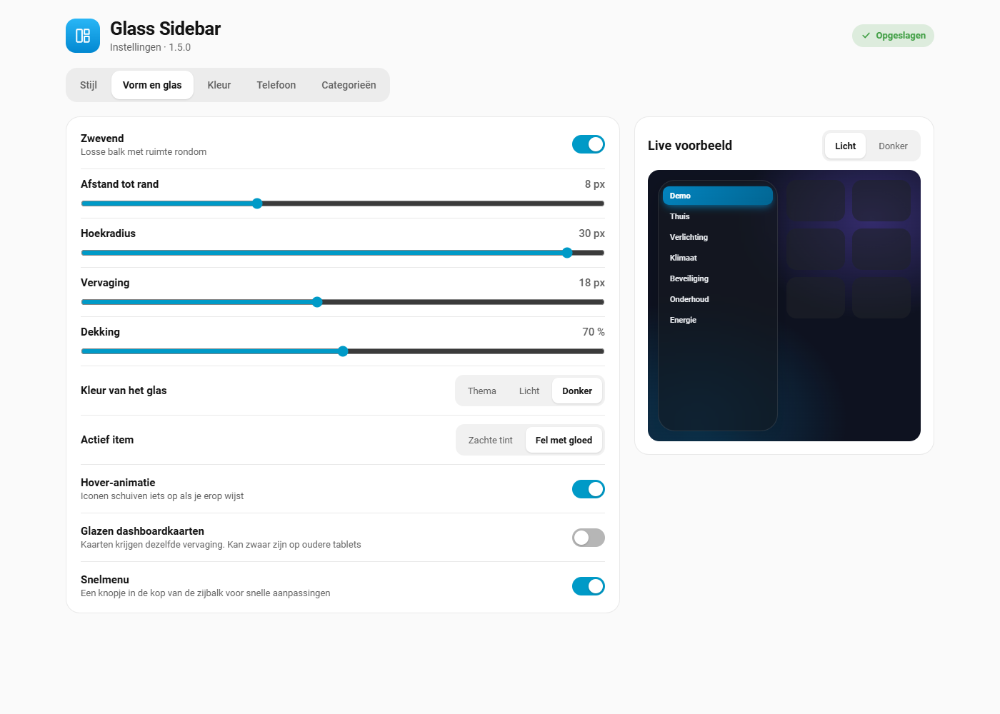
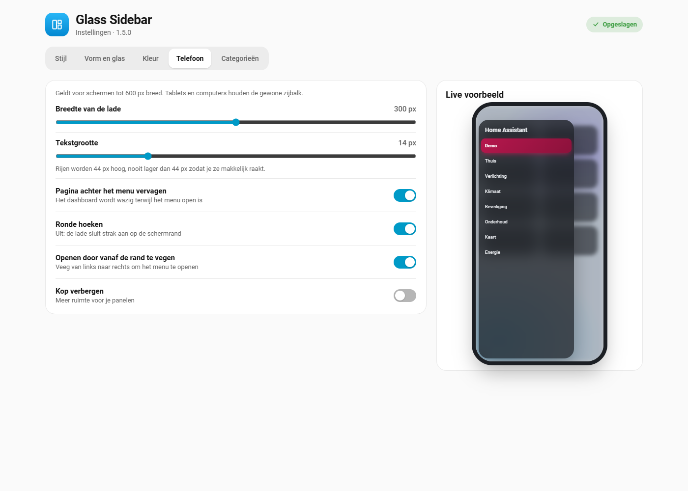
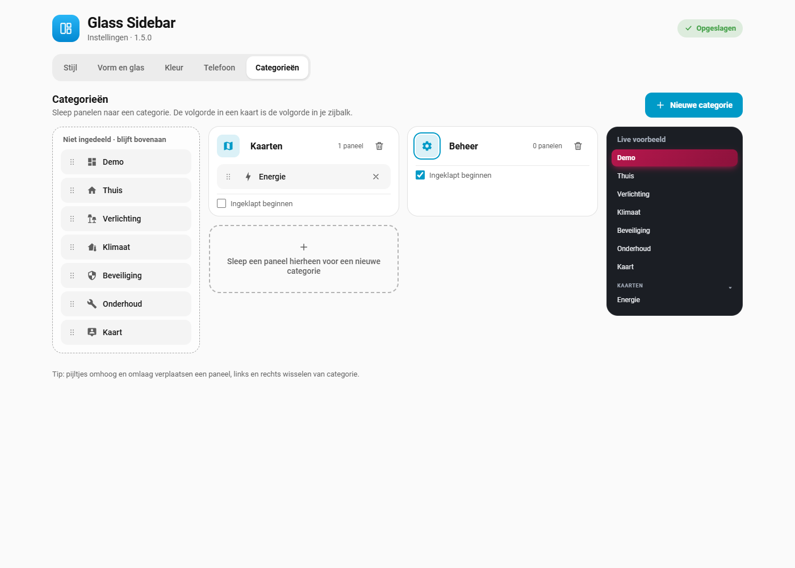
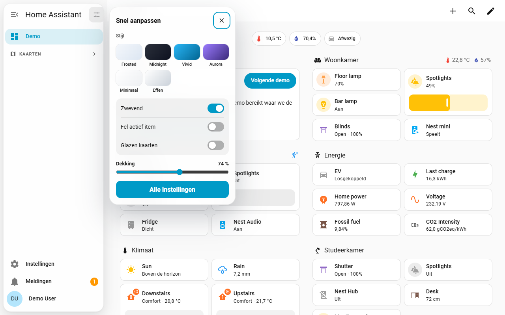

# Glass Sidebar for Home Assistant

A modern, glass-style sidebar for Home Assistant. It turns the left navigation
into a floating panel with soft blur, rounded items and a clear highlight for
the page you're on — and lets you group your panels into your own categories.

It follows your active Home Assistant theme, works in light and dark mode, and
is configured entirely from the UI. No YAML, no extra frontend resources.

> The sidebar images on this page are design previews; the settings page
> screenshots come from Home Assistant itself. Your sidebar uses your own
> theme colors, panels and names.

## Features

- **Floating glass panel** with configurable distance to the screen edge,
  corner radius and blur.
- **Settings page with live preview**: tabs for style, shape and glass,
  color, phone and categories. Every change applies right away.
- **Styles**: six ready-made looks (Frosted, Midnight, Vivid, Aurora, Minimal,
  Solid) and your own saved styles.
- **Categories**: drag panels into your own headings, each with an icon. Tap a
  heading in the sidebar to fold it in or out. On the collapsed sidebar each
  heading becomes a thin divider.
- **Quick menu**: a button in the sidebar header for the most used settings.
- **Vivid highlight** (optional): the page you're on gets a solid accent pill
  with a soft glow.
- **Glass dashboard cards** (optional): your cards get the same frosted look.
- **Theme aware**: uses your theme's colors, or a light or dark glass tint and
  an accent color of your own.
- **Phone drawer**: on phones the menu opens wider, with adjustable text size
  and a blurred page behind it. Optional: open it by swiping from the edge,
  square corners, and no header. Tablets and desktops keep the normal layout.
- **Subtle motion**: icons slide slightly on hover. Can be turned off, and is
  off automatically when your device asks for reduced motion.
- **Notifications** open in the same floating glass panel.
- **Works with sidebar themes**: themes that style the sidebar themselves, such
  as Frosted Glass, keep working for everything else.

## Screenshots

| Light | Dark |
| --- | --- |
|  |  |

| Collapsed | Phone |
| --- | --- |
|  |  |

## Installation

### Marketplace (Home Assistant 2026.11 and newer)

From Home Assistant 2026.11, HACS is built in as the **Marketplace** under
**Settings → Marketplace**. Search for **Glass Sidebar** there. If it isn't
listed yet, add this repository as a custom repository with type
**Integration**, the same way as described for HACS below. If you installed it
through HACS before, it carries over automatically and keeps getting updates.

### HACS (Home Assistant 2026.10 and older)

Click the button above, or add it by hand:

1. In Home Assistant, open **HACS**.
2. Open the menu (⋮) in the top right and choose **Custom repositories**.
3. Add `https://github.com/roykolk20-design/Home-assistant-glasssidebar` with
   type **Integration** (not *Theme* or *Dashboard*, those give a
   "repository structure is not compliant" error).
4. Search for **Glass Sidebar** in HACS and download it.
5. Restart Home Assistant.
6. Go to **Settings → Devices & services → Add integration** and choose
   **Glass Sidebar**.
7. Refresh your browser (Ctrl+F5 / Cmd+Shift+R).

### Manual

1. Download this repository (green **Code** button → **Download ZIP**).
2. Copy the folder `custom_components/glass_sidebar` into the
   `custom_components` folder of your Home Assistant configuration, so you end
   up with `config/custom_components/glass_sidebar/manifest.json`.
3. Restart Home Assistant.
4. Go to **Settings → Devices & services → Add integration** and choose
   **Glass Sidebar**.
5. Refresh your browser.

## Configuration

Go to **Settings → Devices & services → Glass Sidebar** and choose the
**cog** (Configure). The Glass Sidebar settings page opens. Admins can also
open it from the **quick menu** in the sidebar header (*All settings*).

Every change is saved and shown right away, in the preview and in your real
sidebar, on every open browser.

### Style

Pick one of six styles with one click, then fine-tune it on the other tabs.
**Save current settings as a style** to keep your own look; your styles appear
next to the built-in ones and can be removed again.

A style sets floating, distance, radius, blur, opacity, glass tint, selected
item and accent color. Categories and phone settings stay as they are.

### Shape & glass

| Option | Default | What it does |
| --- | --- | --- |
| Floating | On | A separate panel with space around it. Off keeps it attached to the screen edge. |
| Distance to screen edge | 8 px | Space around the floating panel. |
| Corner radius | 20 px | Roundness of the panel. Menu items follow along. |
| Blur | 18 px | Strength of the glass blur. Also used for glass cards. |
| Opacity | 74 % | Lower is more see-through. |
| Glass tint | Theme | *Theme* follows your theme. *Light* or *Dark* gives the glass a fixed color with matching text. |
| Selected item | Soft tint | *Soft tint* or *Vivid with glow*. |
| Hover animation | On | Icons slide slightly when you point at them. |
| Glass dashboard cards | Off | Makes cards translucent. Best with a background image; can be heavy on older tablets. |
| Quick menu | On | The button in the sidebar header. Only admins see it. |

### Color

Use your theme's accent color, or pick one of the swatches or any color of
your own.

### Phone

Applies to screens up to 600 px wide.

| Option | Default | What it does |
| --- | --- | --- |
| Drawer width | 300 px | Width of the menu when it slides in. Never more than 90 % of the screen. |
| Text size | 14 px | Size of the menu text. Rows grow along, but never get smaller than 44 px so they stay easy to tap. |
| Blur the page behind the menu | On | Frosts the dashboard while the menu is open. |
| Rounded corners | On | Off: the drawer sits flush against the screen edge. |
| Open by swiping from the edge | Off | Swipe from the left edge to open the menu. |
| Hide the header | Off | More room for your panels. |

### Categories

- **Drag** a panel by its handle into a category, or within a category to
  change the order. Works with mouse, pen and touch.
- **Keyboard**: focus a handle and use the arrow keys. Up and down change the
  order; left and right move the panel to the previous or next category.
- **New category** adds an empty card; dropping a panel on the dashed area
  creates one too. Click the name to rename it.
- Pick an **icon** for each category with the icon button.
- **Start collapsed** folds the category in by default. In the sidebar you can
  tap a heading to fold it in or out; your browser remembers it. The page
  you're on always stays visible.

Panels you don't put in a category stay at the top in Home Assistant's own
order. Settings, notifications and your profile always stay at the bottom. The
order and visibility you set with Home Assistant's own *Edit sidebar*
(long-press the title) still apply.

### Quick menu

The button in the sidebar header opens a small glass menu with the styles,
switches for floating, vivid highlight and glass cards, the opacity, and a
link to all settings. Settings apply to everyone, so only admins see it.

## Updates

New versions are published as GitHub releases. HACS shows them under
**Settings → Updates** like any other update, with the release notes. Install
it there and restart Home Assistant when asked. Open browsers and the
companion app reload themselves once to pick up the new version; there is no
need to clear the cache.

HACS never installs updates on its own. If you want that, create an
automation that runs the `update.install` action on the Glass Sidebar update
entity when it turns on.

## Compatibility

- Built for **Home Assistant 2026.10** (frontend 20260930) and newer.
- The sidebar is part of Home Assistant's frontend, which isn't a public API.
  A future frontend update can change the elements this plugin styles. If the
  sidebar suddenly looks like the default again after an update, please
  [open an issue](https://github.com/roykolk20-design/Home-assistant-glasssidebar/issues).

## Troubleshooting

**Nothing changes after installing.**
Make sure you added the integration under *Devices & services* (installing
through HACS alone isn't enough), then hard-refresh the browser. In the
companion app: *Settings → Companion app → Debugging → Reset frontend cache*.

**A category doesn't show up.**
A heading only appears when at least one of its panels is in your sidebar.
Check that the panel isn't hidden with *Edit sidebar*. Headings are hidden on
the collapsed sidebar and shown as dividers instead.

**Keyboard navigation follows a different order.**
Categories only change the visual order. Arrow-key navigation inside the
sidebar still follows Home Assistant's original order. This is intentional:
moving the actual elements would break Home Assistant's own updates of the
sidebar.

**Still stuck?** Open the browser console (F12), look for messages that start
with `Glass Sidebar`, and include them in an issue together with your Home
Assistant version.

## Uninstall

1. **Settings → Devices & services → Glass Sidebar → ⋮ → Delete**. The
   sidebar returns to normal right away.
2. Remove the integration in HACS (or delete
   `custom_components/glass_sidebar`) and restart Home Assistant.

## How it works

The integration serves two small JavaScript files: one that Home Assistant
loads on every page, and the settings page, which it registers as a hidden
panel linked to the integration. The script finds the sidebar inside Home Assistant's
shadow DOM and adds a stylesheet to it. Your options are sent to the browser
over Home Assistant's websocket, so changes apply instantly. Categories use
CSS `order` and extra headings. The sidebar's own elements are never moved or
replaced.

## License

[MIT](LICENSE)
